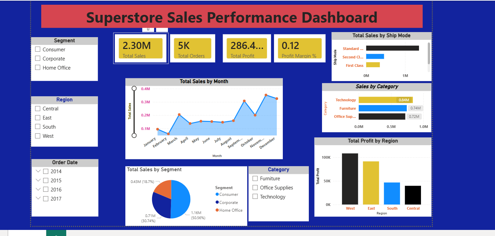

# Superstore Sales Analysis – Power BI Dashboard

## Project Overview

This project presents an interactive Power BI dashboard for analyzing Superstore sales, profit, and business performance.

## Project Objectives

- Analyze total sales and profit.
- Understand regional sales performance.
- Compare product categories.
- Analyze customer segments.
- Identify business trends and insights.

## Tools & Technologies

- Microsoft Power BI
- Data Analytics
- Data Visualization
- Business Intelligence

## Dashboard Features

- Sales and profit analysis
- Region-wise performance
- Category-wise analysis
- Customer segment analysis
- Interactive filters and slicers

## Dashboard Preview

## Project File

[Download Power BI Dashboard](Superstore_Sales_Analysis.pbix)

Open the file using Microsoft Power BI Desktop.

## Skills Demonstrated

- Data Analysis
- Dashboard Development
- Data Visualization
- Business Intelligence

## Author

**Amir Afzal**

BS Data Science Student  
Government College University Faisalabad (GCUF)

GitHub: [AmirAfzal11](https://github.com/AmirAfzal11)

## Purpose

This project was developed for educational purposes and to demonstrate practical data analytics skills.# Superstore-Sales-Analysis-PowerBI
Interactive Power BI dashboard for Superstore sales, profit, and business performance analysis.
